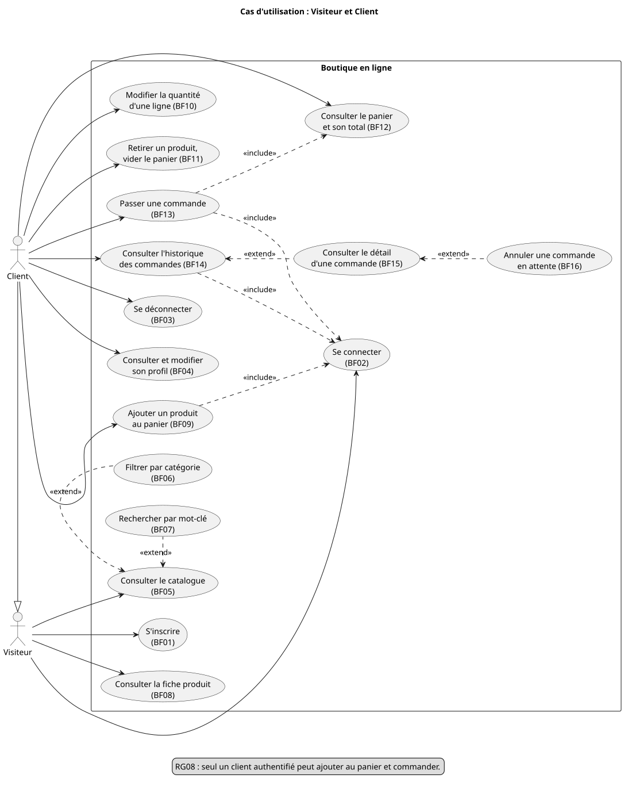
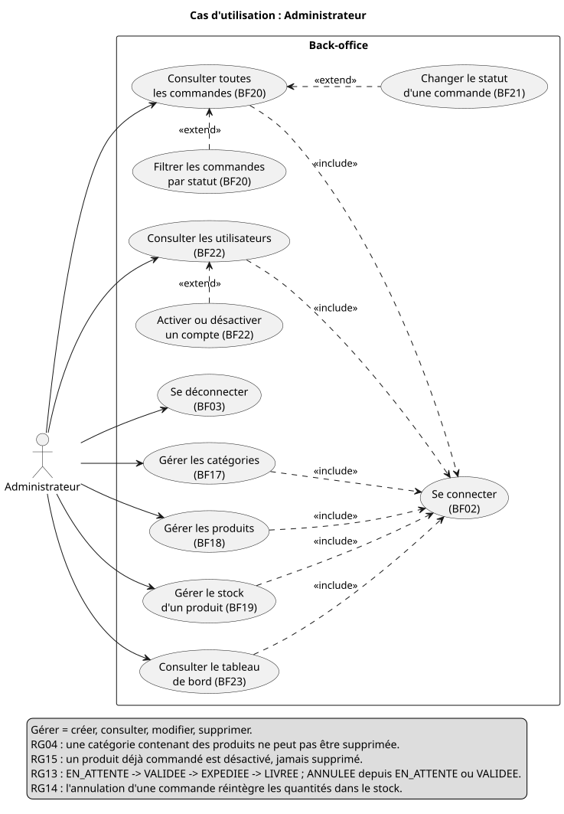
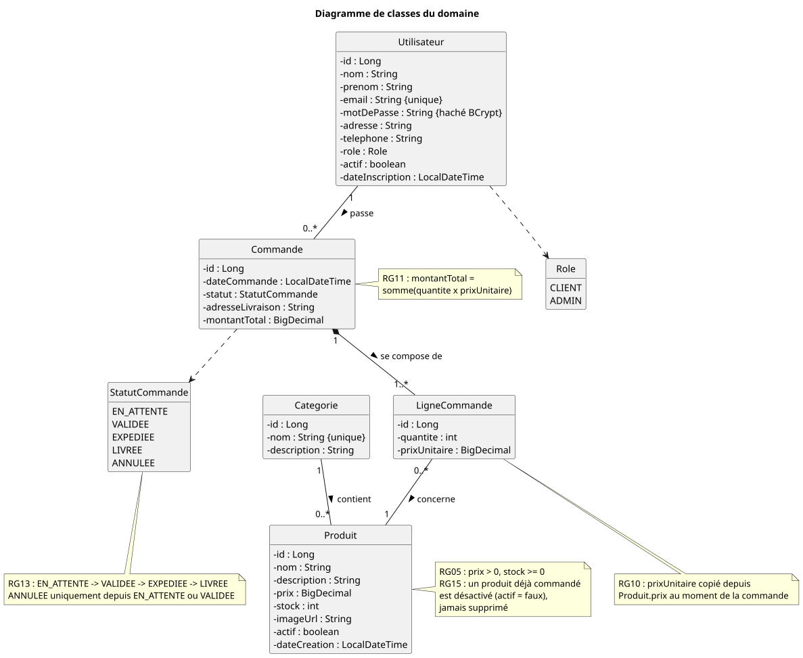
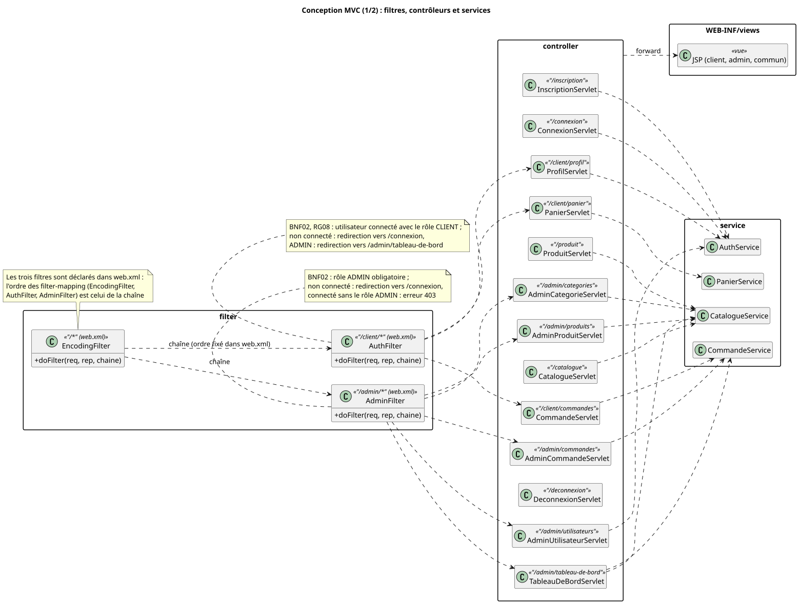
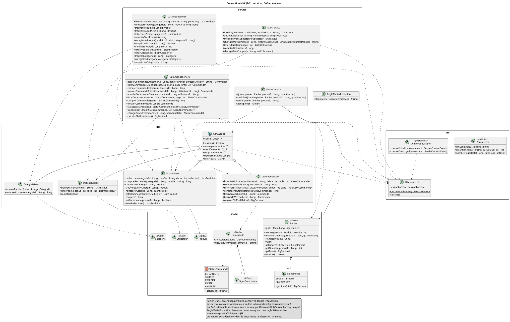
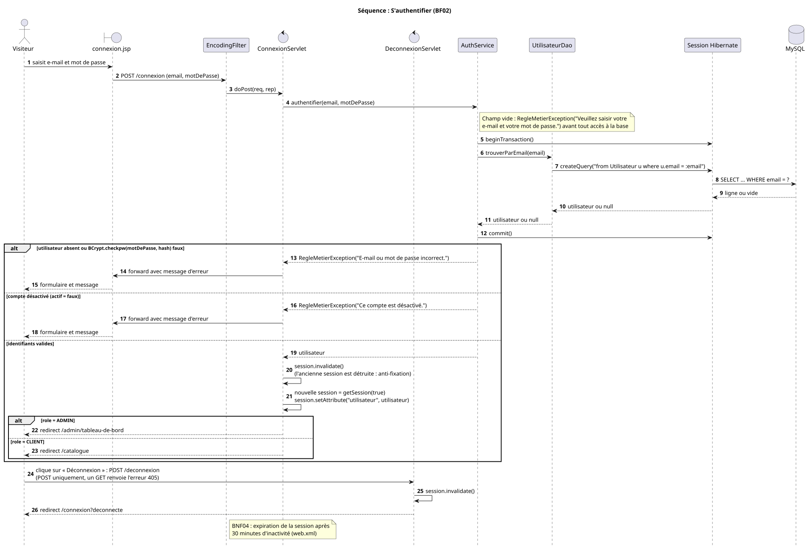
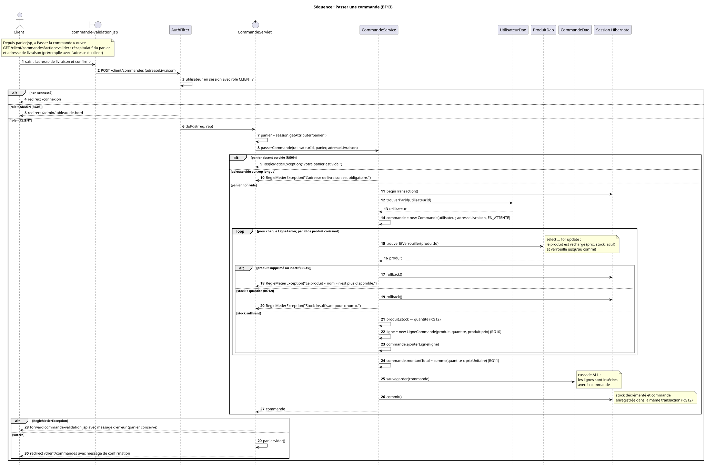
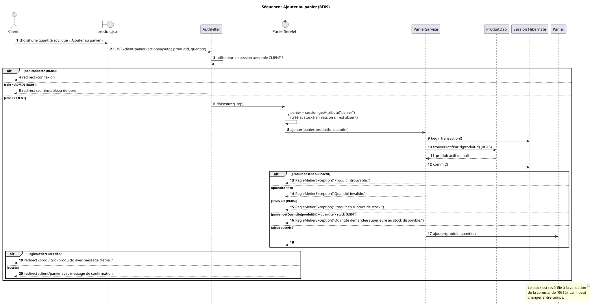
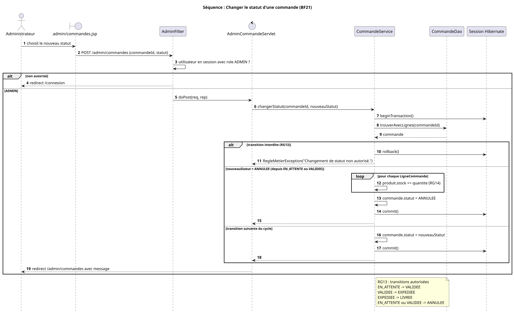

# Rapport de projet : Gestion d'une boutique en ligne

Module Architecture JEE · DLA2 · ENSA Agadir

Binôme : LAHMOUZ Hamza, ELAOUAD Abdelhamid

> Ce document est la base du rapport PDF (sources LaTeX dans `docs/rapport/latex/`). Les diagrammes sont repris de `docs/uml/` (exports SVG) ; les
> captures d'écran sont listées en annexe.

## Sommaire

1. [Introduction et contexte](#1-introduction-et-contexte)
2. [Processus de développement : modèle en Y](#2-processus-de-développement--modèle-en-y)
3. [Modèles UML](#3-modèles-uml)
4. [Descriptions textuelles des cas d'utilisation](#4-descriptions-textuelles-des-cas-dutilisation)
5. [Fonctionnalités réalisées](#5-fonctionnalités-réalisées)
6. [Choix techniques](#6-choix-techniques)
7. [Difficultés rencontrées et solutions](#7-difficultés-rencontrées-et-solutions)
8. [Conclusion et perspectives](#8-conclusion-et-perspectives)
9. [Annexes](#9-annexes)

---

## 1. Introduction et contexte

### 1.1 Contexte

Une petite boutique qui gère ses produits et ses commandes à la main (fichiers Excel, échanges
téléphoniques) s'expose à des erreurs de stock, à une mauvaise traçabilité des commandes et à une
visibilité limitée auprès de ses clients. Le projet consiste à lui fournir une application web de vente en
ligne : un catalogue public, un espace client (panier, commandes, historique, profil) et un back-office
d'administration.

### 1.2 Problématique

Comment offrir à une boutique un outil web simple permettant de publier un catalogue organisé par
catégories, de recevoir des commandes en ligne et d'en suivre le traitement, tout en garantissant la
cohérence des données (stock, prix, historique) ?

### 1.3 Objectifs

1. Permettre aux visiteurs de consulter le catalogue et de rechercher des produits.
2. Permettre aux clients authentifiés de gérer un panier et de passer des commandes.
3. Permettre à l'administrateur de gérer les catégories, les produits, les commandes et les utilisateurs.
4. Concevoir le système avec UML avant son implémentation.
5. Mettre en œuvre une architecture MVC en Jakarta EE (Servlets, JSP, JSTL) avec Hibernate pour la persistance.
6. Versionner le travail avec Git et GitHub (tickets, branches, pull requests).

### 1.4 Périmètre

Le périmètre est celui du cahier des charges (§1.4). Sont **hors périmètre** : le paiement en ligne réel
(le paiement est simulé, à la livraison), la livraison et le suivi transporteur, la gestion multi-boutiques,
l'application mobile et l'envoi d'e-mails transactionnels.

### 1.5 Acteurs

| Acteur | Description | Accès |
|---|---|---|
| Visiteur | Internaute non authentifié | Catalogue, recherche, fiche produit, inscription, connexion |
| Client | Utilisateur connecté avec le rôle CLIENT ; hérite des droits du Visiteur | Panier, commandes, historique, profil |
| Administrateur | Utilisateur connecté avec le rôle ADMIN | Back-office : catégories, produits, stock, commandes, utilisateurs, tableau de bord |

---

## 2. Processus de développement : modèle en Y

### 2.1 Principe

Le projet suit le **modèle en Y** : un processus itératif, piloté par les cas d'utilisation, dans lequel la
capture des besoins fonctionnels et la capture des besoins techniques sont menées en parallèle avant de se
rejoindre dans la branche de conception et de réalisation.

```
   Branche fonctionnelle              Branche technique
   (besoins, cas d'utilisation,       (Java 17, Jakarta EE 10, Tomcat 10.1,
    classes du domaine)                Hibernate 6, MySQL 8, architecture MVC)
              \                          /
               \                        /
                ▼                      ▼
           Conception préliminaire et détaillée
           (classes de conception, séquences)
                         │
                         ▼
           Codage, tests, déploiement (.war)
           itérations successives, une branche par fonctionnalité
```

### 2.2 Branche fonctionnelle

- Rédaction du cahier des charges (`docs/cahier-des-charges.md`) : 23 besoins fonctionnels codés BF01 à BF23
  et priorisés (P1 indispensable, P2 important, P3 souhaitable), 16 règles de gestion RG01 à RG16,
  12 besoins non fonctionnels BNF01 à BNF12.
- Diagrammes de cas d'utilisation (Visiteur/Client et Administrateur), descriptions textuelles (section 4),
  diagramme de classes du domaine.

### 2.3 Branche technique

- Technologies imposées par le module : Java 17, Jakarta EE 10 (Servlet 6.0, JSP 3.1, JSTL 3.0), Tomcat 10.1,
  Hibernate ORM 6, MySQL 8, Maven (packaging `war`), Bootstrap 5, jBCrypt, PlantUML.
- Architecture MVC N-tiers : navigateur, Tomcat (couches web et métier), serveur MySQL.
- Configuration Hibernate (`hibernate.cfg.xml`, génération des tables par `hbm2ddl.auto = update`) et
  configuration web (`web.xml` : session, encodage, pages d'erreur).

### 2.4 Branche de conception et de réalisation

- Conception : diagrammes de classes de conception (couche web, couche métier) et diagrammes de séquence.
  Tous les diagrammes ont été versionnés avant la première ligne de code (commit `4fc0fac`), puis mis à jour
  au fil des itérations quand l'implémentation a précisé la conception (commits `docs:` des branches
  `feature/catalogue`, `feature/commande`, `feature/gestion-commandes`, `feature/p3` et
  `feature/coherence-finale`).
- Réalisation : une itération par groupe de fonctionnalités, chacune livrée sur une branche `feature/*`,
  vérifiée par des tests manuels (navigateur et requêtes HTTP) puis fusionnée dans `main` par pull request.

### 2.5 Itérations et suivi GitHub

Le backlog est suivi dans **GitHub Issues** : un ticket par étape, avec la liste à cocher des codes BF/RG
concernés. Chaque étape est développée sur sa propre branche et fusionnée par une pull request dont la
description reprend les besoins couverts, les règles appliquées et les tests manuels effectués.

| Itération (cahier §8.3) | Étape | Ticket | Branche | Pull request |
|---|---|---|---|---|
| 1 | Modélisation UML (cas d'utilisation, classes, séquences) | #4 | `main` (documentation) | — |
| 1 | Squelette : Maven, Hibernate, entités, encodage | #5 | `feature/squelette` | #1 |
| 2 | Authentification et filtres (BF01 à BF03) | #6 | `feature/authentification` | #2 |
| 2 | Back-office catégories, produits, stock (BF17 à BF19) | #7 | `feature/admin-catalogue` | #3 |
| 2 | Catalogue public (BF05 à BF08) | #8 | `feature/catalogue` | #14 |
| 3 | Panier en session (BF09 à BF12) | #9 | `feature/panier` | #15 |
| 3 | Passage de commande (BF13, RG09 à RG12) | #10 | `feature/commande` | #16 |
| 3 | Historique et gestion des commandes (BF14, BF15, BF20, BF21) | #11 | `feature/gestion-commandes` | #17 |
| 4 | Utilisateurs (BF22), pages d'erreur, validation, responsive | #12 | `feature/finitions` | #18 |
| 4 | Besoins P3 : profil (BF04), annulation client (BF16), tableau de bord (BF23) | #12 | `feature/p3` | #19 |
| 5 | README et rapport | #13 | `feature/livrables` | #20 |
| 5 | Cohérence finale : séquences, ordre des filtres, documentation | #21 | `feature/coherence-finale` | #22 |
| 5 | Rapport final au format PDF (LaTeX) | #23 | `feature/rapport-pdf` | #24 |

Remarques :

- Les tickets et les pull requests partagent la même numérotation sur GitHub, d'où les numéros non
  consécutifs des PR (#1 à #3, puis #14 à #20, puis #22 et #24).
- Le texte « Closes #N » en fin de description de PR ferme automatiquement le ticket à la fusion.
- Les P3 ont été regroupés dans une PR séparée (#19) pour pouvoir être isolés de l'étape 9 si nécessaire.

### 2.6 Conventions Git

- Messages de commit en français, sous la forme `type: description` : `feat` (fonctionnalité), `fix`
  (correction), `docs` (documentation, UML), `style` (présentation), `chore` (configuration du projet).
  Exemples : `feat: passage de commande transactionnel (RG09 à RG12)`,
  `fix: réintégration du stock calculée par la base à l'annulation (RG14)`.
- Un commit par sujet ; les références BF/RG figurent dans le message quand c'est utile.
- Fusion avec un commit de fusion explicite : `fusion: <description> (#N)`, puis suppression de la branche.

---

## 3. Modèles UML

Les sources PlantUML et leurs exports SVG sont dans `docs/uml/`. Le cahier des charges (§8.2) prévoyait six
diagrammes ; trois diagrammes ont été ajoutés car ils décrivent des règles de gestion délicates (panier,
changement de statut) ou parce que la conception MVC était trop dense pour un seul diagramme.

| Diagramme | Fichier | Type |
|---|---|---|
| Cas d'utilisation Visiteur et Client | `cas-utilisation-client` | Cas d'utilisation |
| Cas d'utilisation Administrateur | `cas-utilisation-admin` | Cas d'utilisation |
| Classes du domaine | `classes-domaine` | Classes |
| Conception MVC (1/2) : filtres, contrôleurs, services | `classes-conception-web` | Classes |
| Conception MVC (2/2) : services, DAO, modèle | `classes-conception-metier` | Classes |
| S'authentifier | `sequence-authentification` | Séquence |
| Passer une commande | `sequence-passer-commande` | Séquence |
| Ajouter au panier (ajout) | `sequence-ajouter-panier` | Séquence |
| Changer le statut d'une commande (ajout) | `sequence-changer-statut` | Séquence |

### 3.1 Cas d'utilisation : Visiteur et Client



Le Client hérite du Visiteur (généralisation). Le Visiteur consulte le catalogue (BF05), la fiche produit
(BF08), s'inscrit (BF01) et se connecte (BF02) ; le filtre par catégorie (BF06) et la recherche (BF07)
étendent la consultation du catalogue. Les cas du Client (panier, commande, historique) incluent
« Se connecter » (RG08). « Passer une commande » inclut « Consulter le panier » ; le détail d'une commande
(BF15) étend l'historique et l'annulation (BF16) étend le détail.

### 3.2 Cas d'utilisation : Administrateur



Tous les cas du back-office incluent « Se connecter ». « Gérer » signifie créer, consulter, modifier et
supprimer. Le filtre par statut et le changement de statut étendent la consultation des commandes ;
l'activation ou la désactivation d'un compte étend la liste des utilisateurs. La légende rappelle les règles
RG04, RG13, RG14 et RG15.

### 3.3 Classes du domaine



Cinq entités persistantes : `Utilisateur`, `Categorie`, `Produit`, `Commande`, `LigneCommande`, et deux
énumérations : `Role` (CLIENT, ADMIN) et `StatutCommande` (EN_ATTENTE, VALIDEE, EXPEDIEE, LIVREE, ANNULEE).
`LigneCommande` est une classe d'association porteuse d'attributs (quantité, prix unitaire) entre
`Commande` et `Produit`, à la place d'une association plusieurs-à-plusieurs simple. La relation
`Commande` – `LigneCommande` est une composition (1..* lignes). Les notes rappellent RG05, RG10, RG11, RG13
et RG15.

### 3.4 Conception MVC (1/2) : filtres, contrôleurs et services



Ce diagramme montre les trois filtres, leurs motifs d'URL et leur ordre (déclarés dans `web.xml`, voir
section 6.6), les treize servlets avec leur URL
(`@WebServlet`), le service appelé par chacune et le renvoi vers les JSP de `WEB-INF/views`.
`TableauDeBordServlet` est la seule servlet qui appelle deux services (`CommandeService` et
`CatalogueService`), car le tableau de bord agrège des données des deux domaines.

### 3.5 Conception MVC (2/2) : services, DAO et modèle



Signatures des méthodes des quatre services, de `RegleMetierException`, de `GenericDao<T>` et des quatre DAO
spécifiques, des classes du modèle (dont `Panier` et `LignePanier`, objets de session non persistés) et de
`HibernateUtil`, `DemarrageListener` et `Parametres`. Les noms de méthodes du code sont ceux de ce
diagramme.

### 3.6 Séquence : S'authentifier



`ConnexionServlet` délègue à `AuthService.authentifier`, qui recherche l'utilisateur par e-mail
(HQL à paramètre nommé) et vérifie le mot de passe avec `BCrypt.checkpw`. Trois issues : identifiants
incorrects (même message que l'e-mail existe ou non), compte désactivé, ou succès avec redirection selon le
rôle (tableau de bord pour l'administrateur, catalogue pour le client). Au succès, l'ancienne session est
invalidée et une nouvelle session est créée (contre la fixation de session). Le diagramme montre aussi la
déconnexion, qui n'accepte que la méthode POST (un GET reçoit l'erreur 405).

### 3.7 Séquence : Passer une commande



Séquence centrale du projet. Après le contrôle d'accès (`AuthFilter`), `CommandeService.passerCommande`
ouvre une transaction, recharge chaque produit du panier avec un verrou en écriture (par identifiant
croissant), vérifie qu'il est actif et que le stock suffit, décrémente le stock, crée les lignes avec le prix
courant (RG10), calcule le total (RG11) puis enregistre la commande et ses lignes par cascade. Après le
rechargement de l'utilisateur, un compte désactivé depuis sa connexion est refusé (BF22). Toute
anomalie provoque un rollback (RG12) et la page de validation est réaffichée avec le message, le panier
étant conservé.

### 3.8 Séquence : Ajouter au panier



Montre le refus par `AuthFilter` d'un visiteur ou d'un administrateur (RG08), puis les contrôles de
`PanierService` : produit inexistant ou inactif (`ProduitDao.trouverActifParId`, RG15), quantité invalide, rupture (RG06), quantité cumulée
supérieure au stock (RG07). Le panier est un objet de la session HTTP ; le stock est revérifié à la
validation de la commande.

### 3.9 Séquence : Changer le statut d'une commande



Le diagramme montre d'abord le contrôle d'accès de `AdminFilter` : redirection vers la connexion pour un
visiteur, erreur 403 pour un client. `CommandeService.changerStatut` verrouille la commande, vérifie que la transition est autorisée (RG13) et,
pour une annulation, réintègre les quantités dans le stock (RG14) par une requête `update` calculée par la
base, dans la même transaction que le changement de statut.

---

## 4. Descriptions textuelles des cas d'utilisation

Les messages cités sont ceux affichés par l'application. Sauf mention contraire, chaque refus réaffiche la
page avec un message d'erreur et ne modifie aucune donnée.

### 4.1 S'inscrire (BF01)

| Rubrique | Description |
|---|---|
| Acteur | Visiteur |
| Précondition | Le visiteur n'est pas connecté. |
| Postcondition | Un compte CLIENT actif est créé, mot de passe haché. |
| Règles | RG01, RG02, BNF01 |

**Scénario nominal**

1. Le visiteur ouvre la page « Inscription » (`/inscription`).
2. Il saisit nom, prénom, e-mail, mot de passe, confirmation, et facultativement adresse et téléphone.
3. Le système vérifie les champs obligatoires, le format de l'e-mail, la longueur minimale du mot de passe
   (6 caractères), la longueur des champs et l'égalité des deux mots de passe.
4. Le système vérifie que l'e-mail (enregistré en minuscules, sans espaces) n'est pas déjà utilisé (RG01).
5. Le système crée le compte avec le rôle CLIENT (RG02) et le mot de passe haché par BCrypt (BNF01).
6. Le visiteur est redirigé vers la page de connexion : « Inscription réussie. Vous pouvez vous connecter. »

**Scénarios alternatifs et d'erreur**

- 3a. Champ obligatoire vide : « Le nom, le prénom, l'e-mail et le mot de passe sont obligatoires. »
- 3b. E-mail mal formé : « L'adresse e-mail n'est pas valide. »
- 3c. Mot de passe trop court : « Le mot de passe doit contenir au moins 6 caractères. »
- 3d. Confirmation différente : « Les deux mots de passe ne correspondent pas. »
- 3e. Champ trop long : « Un des champs saisis est trop long. »
- 4a. E-mail déjà utilisé : « Cette adresse e-mail est déjà utilisée. »
- Dans tous ces cas, le formulaire est réaffiché avec les valeurs saisies (sauf le mot de passe).

### 4.2 S'authentifier et se déconnecter (BF02, BF03)

| Rubrique | Description |
|---|---|
| Acteurs | Visiteur (connexion) ; Client, Administrateur (déconnexion) |
| Précondition | Un compte existe pour l'e-mail saisi. |
| Postcondition | Une nouvelle session contient l'utilisateur connecté ; à la déconnexion, la session est invalidée. |
| Règles | BNF01, BNF04 |

**Scénario nominal (connexion)**

1. Le visiteur ouvre « Connexion » (`/connexion`) et saisit son e-mail et son mot de passe.
2. Le système recherche l'utilisateur par e-mail et compare le mot de passe au hachage BCrypt.
3. Le système vérifie que le compte est actif.
4. L'ancienne session est invalidée, une nouvelle session est créée avec l'utilisateur (protection contre
   la fixation de session).
5. Un client est redirigé vers le catalogue, un administrateur vers le tableau de bord.

**Scénario nominal (déconnexion)**

1. L'utilisateur connecté clique sur « Déconnexion » (formulaire POST vers `/deconnexion`).
2. La session est invalidée (le panier est donc vidé) et l'utilisateur est redirigé vers la page de
   connexion : « Vous êtes déconnecté. »

**Scénarios alternatifs et d'erreur**

- 1a. Champ vide : « Veuillez saisir votre e-mail et votre mot de passe. »
- 2a. E-mail inconnu ou mot de passe faux : « E-mail ou mot de passe incorrect. » (même message dans les deux
  cas, pour ne pas révéler l'existence d'un compte).
- 3a. Compte désactivé par l'administrateur : « Ce compte est désactivé. »
- Session inactive pendant 30 minutes : elle expire et l'utilisateur doit se reconnecter (BNF04).

### 4.3 Consulter et rechercher le catalogue (BF05 à BF08)

| Rubrique | Description |
|---|---|
| Acteur | Visiteur (et donc Client) |
| Précondition | Aucune. |
| Postcondition | Aucune modification des données. |
| Règles | RG06, RG15, BNF10 |

**Scénario nominal**

1. Le visiteur ouvre le catalogue (`/catalogue`, page d'accueil de l'application).
2. Le système affiche les produits actifs (RG15), les plus récents d'abord, par pages de 10 (BNF10), avec
   image, nom, catégorie et prix. Un produit à stock 0 reste affiché avec le badge « Rupture » (RG06).
3. Le visiteur choisit une catégorie (BF06) et/ou saisit un mot-clé (BF07) : le système filtre sur la
   catégorie et cherche le mot-clé dans le nom et la description, sans tenir compte de la casse. Les filtres
   sont conservés dans les liens de pagination.
4. Le visiteur ouvre la fiche d'un produit (`/produit?id=N`, BF08) : image, prix, stock, description,
   catégorie.

**Scénarios alternatifs et d'erreur**

- 2a. Aucun produit ne correspond : la liste est vide avec un message.
- 2b. Numéro de page invalide ou hors limites : le système affiche la page existante la plus proche.
- 4a. Produit inconnu, désactivé ou identifiant invalide : retour au catalogue avec « Produit introuvable. »
- 4b. Sur la fiche, un visiteur voit « Connectez-vous pour commander » ; un client voit le formulaire
  « Ajouter au panier » si le produit n'est pas en rupture.

### 4.4 Gérer le panier (BF09 à BF12)

| Rubrique | Description |
|---|---|
| Acteur | Client |
| Précondition | Le client est connecté (RG08, contrôlé par `AuthFilter`). |
| Postcondition | Le panier de la session est à jour ; rien n'est enregistré en base. |
| Règles | RG06, RG07, RG08, RG15 |

**Scénario nominal**

1. Sur la fiche d'un produit, le client choisit une quantité et clique sur « Ajouter au panier » (BF09).
2. Le système recharge le produit depuis la base, vérifie qu'il est actif, que la quantité est un entier
   supérieur ou égal à 1, que le stock n'est pas nul (RG06) et que la quantité déjà au panier plus la
   quantité ajoutée ne dépasse pas le stock (RG07).
3. Le produit est ajouté au panier (ou sa quantité est augmentée) : « Produit ajouté au panier. »
4. Le client ouvre « Panier » (`/client/panier`, BF12) : lignes, sous-totaux et montant total.
5. Il modifie la quantité d'une ligne (BF10, mêmes contrôles RG06 et RG07), retire une ligne ou vide le
   panier (BF11).

**Scénarios alternatifs et d'erreur**

- 1a. Visiteur non connecté : redirection vers `/connexion`. Administrateur : redirection vers le tableau de
  bord (seul un client a un panier).
- 2a. Produit inconnu ou désactivé : « Produit introuvable. »
- 2b. Quantité vide, nulle, négative ou non numérique : « Quantité invalide : indiquez un nombre entier
  supérieur ou égal à 1. »
- 2c. Stock nul : « Produit en rupture de stock. »
- 2d. Quantité cumulée supérieure au stock : « Quantité demandée supérieure au stock disponible (X en stock,
  Y déjà dans votre panier). »
- Après un refus à l'ajout, le client revient sur la fiche du produit avec le message.

### 4.5 Passer une commande (BF13)

| Rubrique | Description |
|---|---|
| Acteur | Client |
| Précondition | Le client est connecté et son panier n'est pas vide. |
| Postcondition | Une commande EN_ATTENTE et ses lignes sont enregistrées, les stocks sont décrémentés, le panier est vidé. |
| Règles | RG09, RG10, RG11, RG12, RG15, BNF05 |

**Scénario nominal**

1. Depuis le panier, le client clique sur « Passer la commande ».
2. Le système affiche la page de validation (`/client/commandes?action=valider`) : récapitulatif du panier
   et adresse de livraison préremplie avec l'adresse du profil.
3. Le client vérifie ou modifie l'adresse et clique sur « Confirmer la commande ».
4. Dans une seule transaction (BNF05), le système recharge le compte du client, puis chaque produit du
   panier avec un verrou en écriture ; il vérifie que le produit est actif et que le stock suffit.
5. Pour chaque ligne, le stock est décrémenté (RG12) et une ligne de commande est créée avec le prix actuel
   du produit (RG10).
6. Le montant total est calculé comme la somme quantité × prix unitaire (RG11) ; la commande est enregistrée
   avec ses lignes, au statut EN_ATTENTE.
7. Le panier est vidé et le client est redirigé vers « Mes commandes » : « Votre commande n° X a bien été
   enregistrée. Montant total : … DH. »

**Scénarios alternatifs et d'erreur**

- 3a. Panier vide (RG09) : « Votre panier est vide. »
- 3b. Adresse vide ou trop longue : « L'adresse de livraison est obligatoire. » / « L'adresse de livraison est
  trop longue (255 caractères maximum). »
- 4a. Compte désactivé depuis la connexion : « Votre compte est désactivé : vous ne pouvez plus commander. »
- 4b. Produit désactivé ou supprimé depuis l'ajout au panier (RG15) : « Le produit « nom » n'est plus
  disponible : retirez-le de votre panier. »
- 4c. Stock insuffisant (RG12) : « Stock insuffisant pour « nom » (X en stock, Y demandé(s)). »
- Dans les cas 4a à 4c, la transaction est annulée (rollback) : aucune commande, aucune ligne, aucun stock
  modifié. La page de validation est réaffichée avec le message et l'adresse saisie ; le panier est conservé.

### 4.6 Consulter ses commandes et annuler une commande (BF14, BF15, BF16)

| Rubrique | Description |
|---|---|
| Acteur | Client |
| Précondition | Le client est connecté. |
| Postcondition | Consultation : aucune modification. Annulation : commande ANNULEE, quantités remises en stock. |
| Règles | RG13, RG14, RG16, BNF10 |

**Scénario nominal**

1. Le client ouvre « Mes commandes » (`/client/commandes`, BF14) : ses commandes uniquement (RG16), les plus
   récentes d'abord, par pages de 10, avec numéro, date, montant et statut.
2. Il ouvre le détail d'une commande (`/client/commandes?id=N`, BF15) : lignes, prix unitaires enregistrés,
   sous-totaux, total, adresse de livraison et statut.
3. Si la commande est « En attente », il clique sur « Annuler la commande » et confirme (BF16).
4. Le système verrouille la commande, vérifie qu'elle appartient au client et qu'elle est EN_ATTENTE, remet
   chaque quantité en stock (RG14) et passe la commande à ANNULEE, dans une même transaction.
5. Le détail est réaffiché : « Votre commande n° X a été annulée. »

**Scénarios alternatifs et d'erreur**

- 2a. Commande d'un autre client, identifiant inconnu ou invalide : retour à la liste avec « Commande
  introuvable. » (le système ne révèle pas l'existence de la commande, RG16).
- 3a. Commande dans un autre statut : le bouton n'est pas affiché ; une requête forgée est refusée avec
  « Seule une commande « En attente » peut être annulée. » (une commande « Validée » ne peut être annulée
  que par l'administrateur).
- 4a. Deux demandes d'annulation simultanées : le verrou les traite l'une après l'autre ; la seconde est
  refusée et le stock n'est réintégré qu'une fois.

### 4.7 Consulter et modifier son profil (BF04)

| Rubrique | Description |
|---|---|
| Acteur | Client |
| Précondition | Le client est connecté. |
| Postcondition | Les informations (ou le mot de passe) sont mises à jour ; le rôle et l'état du compte ne changent pas. |
| Règles | RG01, BNF01 |

**Scénario nominal**

1. Le client ouvre « Mon profil » (`/client/profil`).
2. Il modifie nom, prénom, e-mail, adresse ou téléphone et enregistre.
3. Le système contrôle les champs et vérifie que le nouvel e-mail n'appartient à aucun autre compte (RG01),
   puis enregistre ; l'utilisateur en session est remis à jour : « Votre profil a été mis à jour. »
4. Dans le second formulaire, il saisit son mot de passe actuel, le nouveau et la confirmation ; le système
   vérifie le mot de passe actuel puis enregistre le nouveau haché (BNF01) : « Votre mot de passe a été
   modifié. »

**Scénarios alternatifs et d'erreur**

- 3a. Champ obligatoire vide, e-mail invalide ou déjà utilisé, champ trop long : message et formulaire
  réaffiché.
- 4a. Mot de passe actuel incorrect : « Le mot de passe actuel est incorrect. »
- 4b. Confirmation différente ou nouveau mot de passe de moins de 6 caractères : message d'erreur.

### 4.8 Gérer les catégories, les produits et le stock (BF17, BF18, BF19)

| Rubrique | Description |
|---|---|
| Acteur | Administrateur |
| Précondition | L'administrateur est connecté (`AdminFilter`). |
| Postcondition | Le catalogue est mis à jour. |
| Règles | RG03, RG04, RG05, RG06, RG15 |

**Scénario nominal (catégories, `/admin/categories`)**

1. L'administrateur consulte la liste des catégories.
2. Il crée ou modifie une catégorie (nom obligatoire et unique, description facultative) : « Catégorie
   enregistrée. »
3. Il supprime une catégorie vide : « Catégorie supprimée. »

**Scénario nominal (produits, `/admin/produits`)**

1. L'administrateur consulte la liste paginée de tous les produits, actifs ou non (les inactifs sont grisés).
2. Il crée ou modifie un produit : nom, description, prix, stock, URL de l'image, catégorie, case « Actif ».
3. Le système vérifie la catégorie (RG03), le prix strictement positif après arrondi au centime et le stock
   entier positif ou nul (RG05) : « Produit enregistré. »
4. Il met à jour le stock directement depuis la liste (BF19) : « Stock mis à jour. »
5. Il supprime un produit : s'il n'a jamais été commandé, il est supprimé ; sinon il est désactivé (RG15) et
   disparaît du catalogue public.

**Scénarios alternatifs et d'erreur**

- Catégorie : nom vide ou déjà pris (« Une catégorie porte déjà ce nom. ») ; suppression d'une catégorie qui
  contient des produits, même inactifs (RG04) : « Cette catégorie contient des produits : elle ne peut pas
  être supprimée. »
- Produit : catégorie absente (« Veuillez choisir une catégorie. »), prix nul, négatif ou non numérique
  (« Le prix doit être strictement positif. »), stock négatif (« Le stock doit être un entier supérieur ou
  égal à 0. »), champ trop long.
- Un produit désactivé par RG15 peut être réactivé en cochant « Actif ».
- Identifiant inconnu ou invalide : « Produit introuvable. » / « Catégorie introuvable. »

### 4.9 Gérer les commandes et changer leur statut (BF20, BF21)

| Rubrique | Description |
|---|---|
| Acteur | Administrateur |
| Précondition | L'administrateur est connecté. |
| Postcondition | Le statut de la commande est modifié ; en cas d'annulation, les quantités sont remises en stock. |
| Règles | RG13, RG14 |

**Scénario nominal**

1. L'administrateur ouvre « Commandes » (`/admin/commandes`) : toutes les commandes avec leur client, par
   pages de 10, plus récentes d'abord ; il peut filtrer par statut (BF20).
2. Il ouvre le détail d'une commande ou reste sur la liste.
3. Il choisit le nouveau statut parmi ceux autorisés depuis le statut actuel (RG13) : EN_ATTENTE → VALIDEE
   ou ANNULEE ; VALIDEE → EXPEDIEE ou ANNULEE ; EXPEDIEE → LIVREE.
4. Le système verrouille la commande, contrôle la transition et enregistre : « La commande n° X est
   maintenant « … ». »
5. Pour une annulation (confirmation demandée), chaque quantité est remise en stock dans la même transaction
   (RG14) : « … Le stock a été réintégré. »

**Scénarios alternatifs et d'erreur**

- 3a. Commande LIVREE ou ANNULEE : statut définitif, aucun choix proposé.
- 4a. Transition interdite (requête forgée : même statut, retour en arrière, saut d'étape) : « Changement de
  statut non autorisé : une commande « … » ne peut pas passer à « … ». » ; statut inconnu : « Statut de
  commande inconnu. »
- 4b. Commande inexistante : « Commande introuvable. »
- Un client qui accède à `/admin/*` reçoit une page d'erreur 403 ; un visiteur est redirigé vers la
  connexion.

### 4.10 Gérer les utilisateurs (BF22)

| Rubrique | Description |
|---|---|
| Acteur | Administrateur |
| Précondition | L'administrateur est connecté. |
| Postcondition | Le compte est activé ou désactivé. |
| Règles | RG02 |

**Scénario nominal**

1. L'administrateur ouvre « Utilisateurs » (`/admin/utilisateurs`) : liste paginée (nom, e-mail, téléphone,
   rôle, date d'inscription, état), plus récents d'abord.
2. Il clique sur « Désactiver » (avec confirmation) ou « Activer » pour un compte client.
3. Le système enregistre : un compte désactivé ne peut plus se connecter ni passer de commande.

**Scénarios alternatifs et d'erreur**

- 2a. Compte administrateur : « Un compte administrateur ne peut pas être désactivé. » (ce qui empêche aussi
  l'administrateur de perdre son propre accès).
- 2b. Identifiant inconnu : « Utilisateur introuvable. »
- 3a. Un client déjà connecté au moment de sa désactivation garde sa session jusqu'à sa déconnexion ou son
  expiration, mais ne peut plus commander.

### 4.11 Consulter le tableau de bord (BF23)

| Rubrique | Description |
|---|---|
| Acteur | Administrateur |
| Précondition | L'administrateur est connecté (il arrive sur cette page après la connexion). |
| Postcondition | Aucune modification des données. |
| Règles | RG06, RG15 |

**Scénario nominal**

1. L'administrateur ouvre « Tableau de bord » (`/admin/tableau-de-bord`).
2. Le système affiche le nombre total de commandes et le nombre par statut (chaque statut mène à la liste
   filtrée), le chiffre d'affaires (somme des montants des commandes non annulées, commandes en attente
   comprises) et la liste des produits actifs dont le stock est à 0, avec un lien pour les réapprovisionner.

**Scénarios alternatifs**

- 2a. Base vide : 0 commande, « 0,00 DH », « Aucun produit en rupture. »

---

## 5. Fonctionnalités réalisées

### 5.1 Besoins fonctionnels

Tous les besoins sont réalisés, y compris les besoins P3 (BF04, BF16, BF23).

| Code | Besoin | Priorité | État | Réalisation |
|---|---|---|---|---|
| BF01 | S'inscrire | P1 | Réalisé | `InscriptionServlet`, `AuthService.inscrire` |
| BF02 | Se connecter | P1 | Réalisé | `ConnexionServlet`, `AuthService.authentifier` |
| BF03 | Se déconnecter | P1 | Réalisé | `DeconnexionServlet` (POST, invalidation de la session) |
| BF04 | Consulter et modifier son profil | P3 | Réalisé | `ProfilServlet`, `AuthService.modifierProfil`, `changerMotDePasse` |
| BF05 | Liste des produits disponibles | P1 | Réalisé | `CatalogueServlet`, `CatalogueService.listerProduits` (paginée) |
| BF06 | Filtrer par catégorie | P1 | Réalisé | Paramètre `categorie` du catalogue |
| BF07 | Rechercher par mot-clé | P2 | Réalisé | Paramètre `motCle` (nom et description, insensible à la casse) |
| BF08 | Fiche détaillée d'un produit | P1 | Réalisé | `ProduitServlet`, `CatalogueService.trouverProduitActif` |
| BF09 | Ajouter au panier | P1 | Réalisé | `PanierServlet`, `PanierService.ajouter` |
| BF10 | Modifier la quantité | P1 | Réalisé | `PanierService.modifierQuantite` |
| BF11 | Retirer un produit, vider le panier | P1 | Réalisé | `PanierService.retirer`, `vider` |
| BF12 | Consulter le panier et son total | P1 | Réalisé | `client/panier.jsp`, `Panier.getTotal` |
| BF13 | Passer une commande | P1 | Réalisé | `CommandeServlet`, `CommandeService.passerCommande` |
| BF14 | Historique des commandes | P1 | Réalisé | `CommandeService.listerCommandesClient` (paginé) |
| BF15 | Détail d'une commande | P2 | Réalisé | `CommandeService.trouverCommandeClient` |
| BF16 | Annuler une commande « En attente » | P3 | Réalisé | `CommandeService.annulerCommandeClient` |
| BF17 | CRUD des catégories | P1 | Réalisé | `AdminCategorieServlet`, `CatalogueService` |
| BF18 | CRUD des produits | P1 | Réalisé | `AdminProduitServlet`, `CatalogueService` |
| BF19 | Gérer le stock | P1 | Réalisé | `CatalogueService.modifierStock` |
| BF20 | Consulter et filtrer les commandes | P1 | Réalisé | `AdminCommandeServlet`, `CommandeService.listerCommandes` |
| BF21 | Changer le statut d'une commande | P1 | Réalisé | `CommandeService.changerStatut` |
| BF22 | Utilisateurs, activer ou désactiver | P2 | Réalisé | `AdminUtilisateurServlet`, `AuthService.changerEtatCompte` |
| BF23 | Tableau de bord | P3 | Réalisé | `TableauDeBordServlet` |

### 5.2 Règles de gestion

| Code | Mise en œuvre |
|---|---|
| RG01 | `AuthService` : recherche par e-mail avant l'inscription et la modification du profil ; contrainte d'unicité en base. |
| RG02 | `AuthService.inscrire` force le rôle CLIENT ; le premier ADMIN est créé par `docs/sql/admin.sql`. |
| RG03 | `CatalogueService.enregistrerProduit` exige une catégorie existante ; `@ManyToOne(optional = false)`. |
| RG04 | `CatalogueService.supprimerCategorie` refuse si `CategorieDao.compterProduits` > 0 (produits inactifs compris). |
| RG05 | `CatalogueService` : prix > 0 après arrondi au centime, stock ≥ 0 ; colonnes `DECIMAL(10,2)`. |
| RG06 | Produit à stock 0 affiché avec le badge « Rupture » ; refusé par `PanierService`. |
| RG07 | `PanierService` : quantité au panier + quantité demandée ≤ stock. |
| RG08 | `AuthFilter` sur `/client/*` (panier et commandes) : rôle CLIENT obligatoire. |
| RG09 | `CommandeService.passerCommande` refuse un panier vide. |
| RG10 | Le prix du produit relu en base est copié dans `LigneCommande.prixUnitaire`. |
| RG11 | Total calculé par le service à partir des lignes. |
| RG12 | Décrément du stock et enregistrement dans une transaction ; rollback au premier stock insuffisant. |
| RG13 | `CommandeService.statutsSuivants` : seules les transitions du cycle sont acceptées et proposées. |
| RG14 | Réintégration des quantités à l'annulation (`ProduitDao.reintegrerStock`), même transaction. |
| RG15 | `CatalogueService.supprimerProduit` désactive un produit déjà commandé ; le catalogue filtre `actif = true`. |
| RG16 | `CommandeService.trouverCommandeClient` et `annulerCommandeClient` vérifient le propriétaire. |

### 5.3 Besoins non fonctionnels

| Code | Mise en œuvre |
|---|---|
| BNF01 | Mots de passe hachés avec jBCrypt (`BCrypt.hashpw`, `checkpw`). |
| BNF02 | `AuthFilter` (`/client/*`, rôle CLIENT) et `AdminFilter` (`/admin/*`, rôle ADMIN). |
| BNF03 | HQL à paramètres nommés uniquement ; affichage des données par `<c:out>`. |
| BNF04 | Session invalidée à la déconnexion ; `session-timeout` de 30 minutes dans `web.xml`. |
| BNF05 | Passage de commande et changement de statut dans une seule transaction Hibernate. |
| BNF06 | Couches contrôleur, service, DAO, modèle ; aucun scriptlet dans les JSP. |
| BNF07 | Messages de confirmation et d'erreur en français, contrôles HTML5 alignés sur le serveur, pages d'erreur 400, 403, 404, 405, 500. |
| BNF08 | Bootstrap 5 : grille, tableaux `table-responsive`, barre de navigation repliable. |
| BNF09 | Base `utf8mb4`, `EncodingFilter`, JSP en UTF-8 (`web.xml`), connexion JDBC en UTF-8. |
| BNF10 | Pagination par 10 : catalogue, produits, commandes (client et administrateur), utilisateurs. |
| BNF11 | Archive `boutique.war` déployée sur Tomcat 10.1 (Jakarta EE 10, espace de noms `jakarta.*`). |
| BNF12 | Dépôt GitHub, une branche par fonctionnalité, fusion par pull request (section 2.5). |

---

## 6. Choix techniques

### 6.1 Architecture en couches

Chaque requête traverse les couches dans un seul sens : filtre → servlet → service → DAO → Hibernate.

- **Servlets** (`controller`) : lecture des paramètres, appel d'un service, dépôt des attributs, puis
  `forward` vers une JSP de `WEB-INF/views` ou redirection après un POST. Aucune règle métier ni requête HQL.
- **Services** (`service`) : toutes les règles de gestion et les transactions. Une violation de règle lève
  une `RegleMetierException` dont le message, en français, est affiché par la JSP.
- **DAO** (`dao`) : accès aux données uniquement. `GenericDao<T>` fournit le CRUD commun (`sauvegarder`,
  `modifier`, `supprimer`, `trouverParId`, `listerTous`), les DAO spécifiques ajoutent les requêtes HQL.
- **Modèle** (`model`) : entités JPA annotées et objets du panier.
- **Utilitaires** (`util`) : `HibernateUtil`, `DemarrageListener` (création de la `SessionFactory` au
  déploiement, fermeture à l'arrêt), `Parametres` (lecture des paramètres numériques : une valeur absente ou
  mal formée ne provoque jamais d'erreur 500).

### 6.2 Hibernate natif et session liée au thread

- `SessionFactory` unique créée par `HibernateUtil` à partir de `hibernate.cfg.xml`, sans couche
  `EntityManager` ni framework d'injection.
- `hibernate.current_session_context_class = thread` : le service ouvre la transaction sur
  `getCurrentSession()`, les DAO utilisent la même session sans la gérer. Chaque service dispose d'une
  méthode privée `enTransaction` qui valide (commit) ou annule (rollback) la transaction.
- Tables générées par `hbm2ddl.auto = update` à partir des annotations.
- Associations `@ManyToOne` chargées immédiatement (comportement JPA par défaut), ce qui permet aux JSP
  d'afficher la catégorie d'un produit ou le client d'une commande après la fermeture de la session.
  `Commande.lignes` est chargée à la demande ; le détail d'une commande utilise une requête `join fetch`
  (`CommandeDao.trouverAvecLignes`) pour charger lignes et produits en une seule fois.

### 6.3 Cohérence du stock

- **Passage de commande** : chaque produit est relu avec un verrou pessimiste en écriture
  (`LockMode.PESSIMISTIC_WRITE`, soit `select … for update`). Deux commandes simultanées sur le même produit
  sont traitées l'une après l'autre, ce qui empêche de vendre plus que le stock. La requête HQL ne verrouille
  que la ligne du produit (et non celle de sa catégorie), et les produits sont verrouillés par identifiant
  croissant afin que deux transactions prennent les verrous dans le même ordre et ne puissent pas se bloquer
  mutuellement.
- **Annulation** : la commande est verrouillée avant le changement de statut, si bien que deux annulations
  simultanées ne réintègrent le stock qu'une fois. Les quantités sont rendues par une requête HQL
  `update Produit p set p.stock = p.stock + :quantite`, calculée par la base sur la valeur actuelle du stock :
  une vente validée entre-temps par une autre transaction n'est pas écrasée.
- **Prix** : le prix est relu en base à la validation et copié dans la ligne de commande (RG10) ; le prix
  conservé dans le panier ne sert qu'à l'affichage.

### 6.4 Panier en session

Le panier (`Panier`, `LignePanier`) est un objet simple stocké dans la `HttpSession`, jamais persisté
(cahier §7). Les lignes sont indexées par identifiant de produit dans une `LinkedHashMap` (ordre d'ajout
conservé). Le service recharge le produit à chaque ajout ou modification pour contrôler le stock réel.
Conséquence assumée : le panier est perdu à la déconnexion ou à l'expiration de la session.

### 6.5 Navigation : PRG et messages flash

Après chaque POST qui modifie des données, la servlet redirige (modèle Post/Redirect/Get) : un
rafraîchissement de la page ne renvoie pas le formulaire. Le message de confirmation ou d'erreur est déposé
en session (`flashSucces`, `flashErreur`) puis affiché une seule fois et retiré par l'en-tête commun.
Quand la saisie doit être corrigée (inscription, profil, validation de commande), la servlet fait un
`forward` vers le formulaire avec le message et les valeurs saisies.

### 6.6 Sécurité

- **Contrôle d'accès** par filtres (BNF02) : `AuthFilter` (`/client/*`) exige le rôle CLIENT, un visiteur
  est redirigé vers la connexion et un administrateur vers son tableau de bord ; `AdminFilter` (`/admin/*`)
  exige le rôle ADMIN, un visiteur est redirigé vers la connexion et un client reçoit une erreur 403.
  Les trois filtres (`EncodingFilter`, `AuthFilter`, `AdminFilter`) sont déclarés dans `web.xml` : seul
  l'ordre des `<filter-mapping>` est garanti par la spécification Servlet, ce qui assure que
  `EncodingFilter` s'exécute en premier.
- **Mots de passe** hachés avec BCrypt (sel intégré) ; message d'échec identique que l'e-mail existe ou non.
- **Injection SQL** : toutes les requêtes HQL utilisent des paramètres nommés ; la requête de recherche du
  catalogue est construite dynamiquement, mais seules des clauses fixes sont concaténées, jamais une valeur
  saisie.
- **XSS** : toutes les données saisies par les utilisateurs sont affichées par `<c:out>`, qui échappe le HTML.
- **Session** : nouvel identifiant de session à la connexion (contre la fixation de session), identifiant
  transmis uniquement par cookie (`tracking-mode COOKIE`, jamais dans l'URL), invalidation à la déconnexion,
  expiration après 30 minutes. La déconnexion se fait uniquement en POST.
- **Contrôles côté serveur** : toutes les règles sont vérifiées dans les services, même si un formulaire
  est contourné ; par exemple, un statut de commande forgé est refusé et une commande d'un autre client est
  traitée comme inexistante (RG16).

### 6.7 Présentation

- JSP uniquement en JSTL et EL, sans scriptlet (BNF06) ; en-tête et pied de page communs inclus dans chaque
  page, fragments communs pour la pagination, le badge de statut et le résumé d'une commande.
- Bootstrap 5.3 par CDN, mise en page responsive (BNF08).
- Prix affichés avec `fmt:formatNumber` (deux décimales, format français, en DH) ; dates formatées par
  l'entité (`getDateCommandeFormatee`), car `fmt:formatDate` ne prend pas en charge `LocalDateTime`.
- Libellés français des statuts portés par l'énumération `StatutCommande`.

### 6.8 Pages d'erreur

Une seule page `commun/erreur.jsp`, déclarée dans `web.xml` pour les codes 400, 403, 404, 405 et 500 et pour
toute exception non interceptée. Elle affiche un message en français avec l'en-tête et le pied communs, sans
trace technique ni version du serveur.

### 6.9 UTF-8 de bout en bout

Base et tables en `utf8mb4` (collation `utf8mb4_unicode_ci`, qui rend aussi la recherche insensible aux
accents), connexion JDBC en UTF-8, `EncodingFilter` sur toutes les requêtes (lecture des paramètres et
réponse), encodage des JSP fixé dans `web.xml`, sources compilées en UTF-8 (`pom.xml`).

---

## 7. Difficultés rencontrées et solutions

_Section rédigée par Hamza._

---

## 8. Conclusion et perspectives

### 8.1 Bilan

L'application couvre l'ensemble du cahier des charges : les 23 besoins fonctionnels (P1, P2 et P3), les
16 règles de gestion, contrôlées dans la couche service, et les besoins non fonctionnels de sécurité, de
fiabilité et d'ergonomie. La démarche du modèle en Y a permis de fixer les cas d'utilisation et la
conception avant le code, puis de faire évoluer les diagrammes de conception avec l'implémentation.
Le passage de commande, transactionnel et protégé contre les accès concurrents, constitue le cœur
technique du projet.

### 8.2 Perspectives

Améliorations possibles, hors du périmètre actuel :

- Paiement en ligne réel (le paiement est aujourd'hui simulé, à la livraison).
- Envoi d'e-mails transactionnels (confirmation de commande, changement de statut).
- Suivi de livraison avec un transporteur.
- Panier persistant en base, conservé entre deux connexions.
- Envoi d'images de produits (aujourd'hui une URL d'image est saisie).
- Contrôle de l'état du compte à chaque requête, pour déconnecter immédiatement un client désactivé.
- Signalement dans le panier des produits devenus indisponibles avant la validation.
- Tests automatisés (tests unitaires des services, tests d'intégration des DAO).
- Pool de connexions de production (par exemple HikariCP) à la place du pool intégré d'Hibernate.

---

## 9. Annexes

### 9.1 Captures d'écran

Les captures figurent dans l'annexe A de la version PDF ; les fichiers PNG sont dans
`docs/rapport/latex/captures/`. Elles ont été prises sur l'application déployée en local avec un jeu de
données de démonstration.

- [x] Catalogue : liste paginée, filtre par catégorie, recherche
- [x] Fiche produit (client, visiteur sur un produit en rupture)
- [x] Inscription et connexion (avec un message d'erreur)
- [x] Panier avec plusieurs lignes et total
- [x] Page de validation de la commande, puis message de confirmation
- [x] Refus de commande pour stock insuffisant
- [x] Historique « Mes commandes » et détail d'une commande, bouton d'annulation
- [x] Profil du client
- [x] Tableau de bord de l'administrateur
- [x] Back-office : liste des catégories, formulaire produit, liste des produits
- [x] Back-office : liste des commandes filtrée, changement de statut, détail
- [x] Back-office : liste des utilisateurs
- [x] Pages d'erreur 403 et 404
- [x] Affichage mobile (barre de navigation repliée et dépliée)
- [x] Tables générées dans MySQL (sortie du client `mysql`)
- [x] Pull requests et historique des commits sur GitHub

### 9.2 Références

- Cahier des charges : `docs/cahier-des-charges.md`
- Diagrammes UML : `docs/uml/` (sources `.puml`, exports `.svg`)
- Installation et déploiement : `README.md`
- Script du premier administrateur : `docs/sql/admin.sql`
